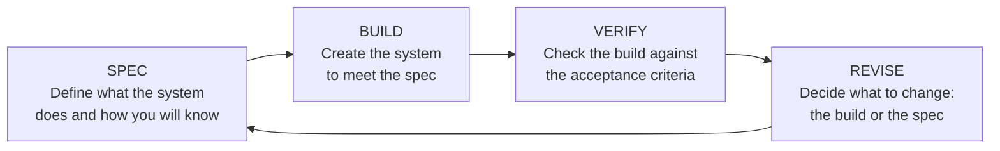

# Cycle Overview

---

The FAQ assistant is live. Every critical acceptance criterion passed on all 5 runs. The late-penalty question now gets the correct answer from handbook version 2 — 5% per day, up to 48 hours, with Section 4.3 cited. The coordinator signed off. Students are using it.

The team feels like they have finished.

Two weeks later, the coordinator forwards a summary of what students have been asking. One question appears more than thirty times:

*"Can I get an extension?"*

The assistant handles it correctly by its spec. The handbook says extensions need coordinator approval, so the assistant says that and points students to the coordinator. FR-04 passes. NFR-05 passes.

But the coordinator's inbox is now full of students asking the same follow-up: *"Where do I apply?"* The handbook has an extension request form in Section 4.4. The assistant never mentions it, because no requirement ever asked it to.

Nothing is broken. The system does exactly what was specified. But what students need has moved on, and the spec has not moved with it.

This is the point many beginners miss: **SDD is not a one-time sequence. It is a cycle.** The spec does not stop at launch. It keeps up with the system.

---

## The Four Stages

The SDD cycle has four stages. You have already seen the first three in order — spec first, then build, then check. The fourth is what turns that line into a loop.



| Stage | The question it answers | What it produces |
|---|---|---|
| **Spec** | What should the system do, and how will we know? | Functional and non-functional requirements, acceptance criteria |
| **Build** | How do we make the system meet the spec? | The instructions, documents and settings — the implementation |
| **Verify** | Does the build actually meet the spec? | Test results, checked against the acceptance criteria |
| **Revise** | What needs to change, and where? | A decision: fix the build, update the spec, or both |

Then the cycle starts again — with a better spec, a better build, or both.

---

## You Have Already Been Through the Cycle

Look back at the FAQ assistant's story. Without naming it, the team went round this cycle several times:

| What happened | Stage |
|---|---|
| Team writes functional requirements FR-01 to FR-07 | **Spec** |
| New version built and tested — passes every FR, fails at launch on speed, length, tone and consistency | **Build → Verify** |
| Team adds non-functional requirements NFR-01 to NFR-06 | **Revise → Spec** |
| Coordinator's deadline request rewritten with SMART into FR-08 | **Spec** |
| Test run: 46 of 50 pass — the late-penalty answer still invented on 1 run in 5 | **Verify** |
| Team fixes the build so it no longer invents penalties | **Revise → Build** |
| Coordinator adds the late policy to the handbook — scenarios updated for version 2 | **Revise → Spec** |
| Critical criteria pass on all runs — the coordinator signs off | **Verify** |
| Students start asking where to apply for extensions | **Revise** — the next cycle begins |

Every stage has happened more than once. That is normal. A system improves by going round the cycle, not by getting everything right on the first pass.

---

## This Is Not the Same Loop as Before

In **Why SDD for AI Systems**, you saw a different loop — **prompt whack-a-mole**. The team fixed one problem, broke another, fixed that, and after five rounds could not tell whether the chatbot was better or worse.

That was also a loop. So what is the difference?

| Prompt whack-a-mole | The SDD cycle |
|---|---|
| Changes are made in response to whatever someone just noticed | Changes are made in response to a failed criterion or a deliberate spec update |
| No fixed definition of "correct" | Acceptance criteria define "correct" before testing |
| Each fix is checked on the one question that prompted it | Every change is verified against the full test set |
| Nobody knows if the system is improving | Every cycle shows exactly which criteria pass and fail |

Both loops go round. Only one of them has a **target**. The spec and acceptance criteria are what turn trial and error into steady improvement.

---

## What Starts a New Cycle

A new cycle can be triggered in four common ways:

**1 — Verification fails**
A criterion does not pass. The late-penalty answer was invented on one run in five. Something must change before release.

**2 — The context changes**
The documents the AI system depends on are updated. When handbook version 2 added a late policy, the expected answer to the same question changed — so the spec and the scenarios had to change too.

**3 — Users need something new**
Real use shows a gap the spec never covered. Students asking *"Where do I apply for an extension?"* is exactly this.

**4 — A stakeholder asks for something**
The coordinator's request for deadline reminders started a cycle that produced FR-08.

Notice that only the first trigger is a failure. The other three happen even when the system is working perfectly. **A system that passes all its criteria can still need a new cycle** — because the world around it has changed.

---

## The Key Decision: Fix the Build or Fix the Spec?

Every time the cycle reaches **Revise**, the team has to answer one question:

```text
Did the system fail to do what the spec says?
    → Fix the BUILD. The spec was right; the system was not.
      Example: the assistant invented a penalty that FR-05 forbids.

Did the system do exactly what the spec says, but it was not enough?
    → Fix the SPEC. The system was right; the spec was incomplete.
      Example: the assistant redirected extension questions correctly,
      but the spec never asked it to mention the form.
```

Getting this decision wrong is costly. If the spec is the problem and the team only changes the build, the fix is undocumented — and the next person to change the system may undo it without knowing. If the build is the problem and the team changes the spec instead, they are lowering the standard to match the result. That is moving the goalposts again.

The next topic looks at this decision — and each of the four stages — in detail.

---

## Keeping Each Cycle Small

A cycle does not have to be large. In fact, smaller is usually better.

The extension-form change is a good example. It needs one new functional requirement, one or two new scenarios, a small change to the assistant's instructions, and one full test run. It can go round the whole cycle in an afternoon.

Small cycles have three advantages:

- **Easier to verify** — when only one thing changed, a failure points straight at it
- **Easier to undo** — if a change makes things worse, it is simple to go back
- **Faster feedback** — students get the improvement sooner, and the team learns sooner whether it worked

This is the same advice you will find in almost every guide to testing AI systems: change one thing at a time, then test everything.

---

## Quick Recap

- SDD is a cycle, not a one-time sequence: **Spec → Build → Verify → Revise**, then back to Spec
- Each stage answers a different question and produces something specific — requirements and criteria, an implementation, test results, and a decision
- The FAQ assistant has already been through the cycle many times — every improvement in its story fits a stage
- The SDD cycle differs from prompt whack-a-mole because it has a fixed target: acceptance criteria agreed before testing
- New cycles start when verification fails, the context changes, users need something new, or a stakeholder asks for something
- At Revise, the key decision is whether to fix the build or fix the spec
- Small cycles are easier to verify, easier to undo and give faster feedback

> **Interview tip:** If asked "how do you maintain an AI system after launch?", describe the SDD cycle — and stress that a system passing all its tests can still need a new cycle, because documents change and users ask new things. Then mention the Revise decision: fix the build when the system fails its spec, fix the spec when the spec itself was incomplete. Candidates who explain that distinction show they understand that specifications are living documents, not paperwork written once at the start.

---

## What Is Next

The next topic walks through each stage of the cycle in detail — **Spec, Build, Verify, Revise** — by following the extension-form change all the way round, from the first line of the new requirement to the coordinator's sign-off.
